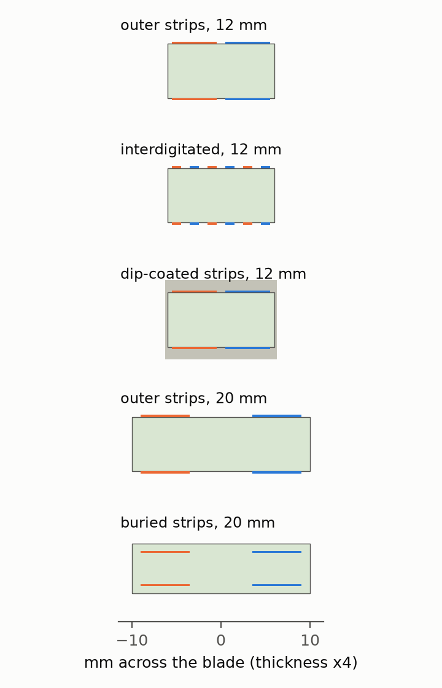
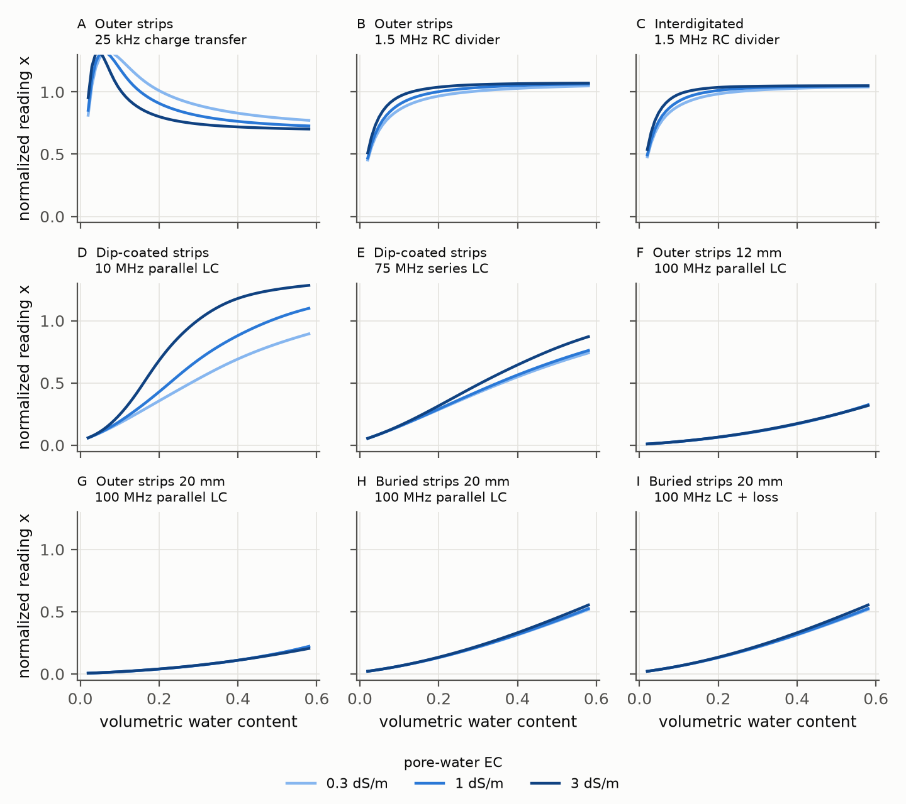
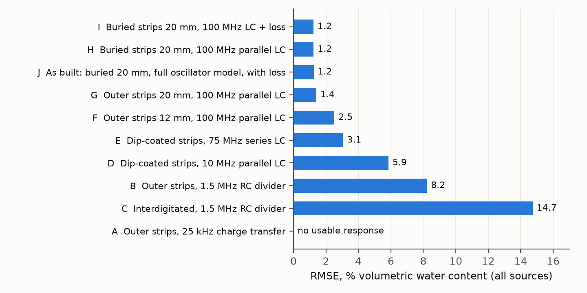
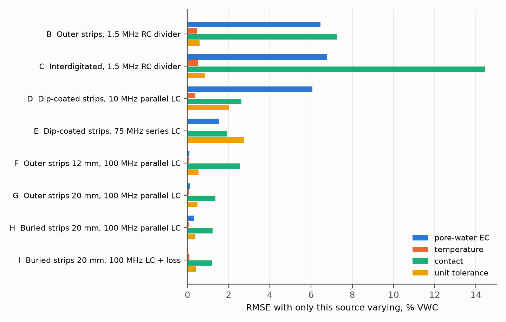
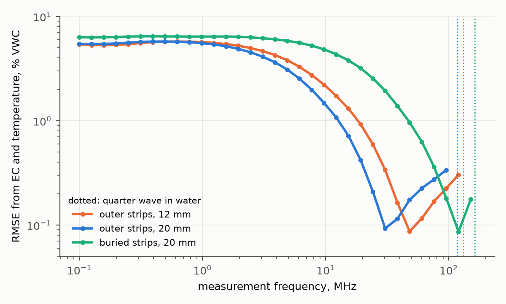
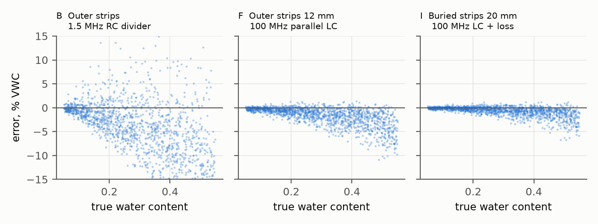
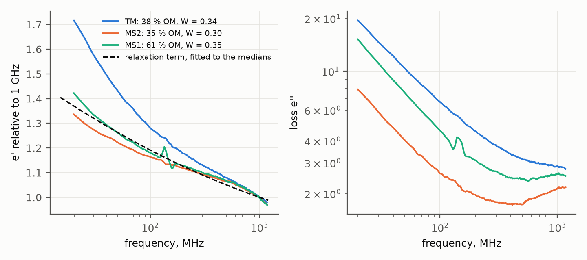

# Accuracy of printed-circuit capacitive soil-moisture probes in potting substrate: a simulation comparison of electrode geometry, measurement frequency and readout principle

**Keywords:** soil water content; capacitance sensor; frequency-domain sensor; soilless substrate; electrical conductivity; Maxwell–Wagner polarization; printed circuit board

## Abstract

Low-cost capacitive probes etched on printed circuit boards are widely used to schedule
irrigation of container-grown plants, yet it is rarely clear whether electrode, measurement
frequency or readout circuit limits their accuracy. We compare nine designs, drawn from five
electrode cross-sections and six readout models from 25 kHz to 100 MHz, in one framework: a two-dimensional complex-permittivity field solution, a
transmission-line model of the 80 mm electrodes, an idealized model of each readout, an
identical two-step calibration, and a paired Monte Carlo evaluation in a peat-based substrate
under nominal greenhouse conditions (pore-water conductivity 0.3–4 dS m⁻¹, 22 ± 4 °C,
imperfect contact, manufacturing tolerance). The substrate-specific calibration is assumed
known. Root-mean-square error ranges from 8–15 % volumetric water content for resist-covered
electrodes read at 1.5 MHz to 1.2 % for electrodes buried in the laminate and read by a
parallel-resonant oscillator at 100 MHz; at 25 kHz resist-covered electrodes give no usable
response. Below about 10 MHz salinity alone contributes 6 %,
whatever the electrode pattern, and a thin air layer contributes as much again when
only solder resist covers the copper. At 75–100 MHz the details decide: a series-resonant
oscillator carries 1.0 % of salinity error against 0.1–0.3 % for a parallel-resonant one on the
same electrodes, and a hand-applied coat adds 2.8 % of unit-to-unit error. With frequency and
readout right, the remaining error is contact; wider electrode spacing and burial under 0.2 mm
of laminate reduce it from 2.5 to 1.4 and 1.2 %. The usable frequency window is bounded below
by interfacial polarization and above by the electrodes' quarter-wave resonance in water. A
substrate relaxation shaped on published spectra of organic soils leaves the ordering
unchanged; if it follows pore-water conductivity, an assumption, frequency-only designs
degrade to 1.7–3.1 % and a design that also measures loss holds 1.3–1.4 %. A circuit-level model of the best design gives 1.0–1.2 %.

## 1. Introduction

Dielectric sensors estimate volumetric water content θ from the permittivity of the medium,
which is dominated by water (relative permittivity 79 at 22 °C against 3–5 for soil minerals)
[Topp et al. 1980; Roth et al. 1990]. Capacitance and frequency-domain sensors are the cheapest members of the
family. Their known weaknesses are sensitivity to the electrical conductivity (EC) of the
pore water, to temperature and to the soil–electrode contact, all of which grow as the
measurement frequency falls [Kizito et al. 2008; Bogena et al. 2017; Kelleners et al. 2005;
Chen and Or 2006]. A capacitance sensor operating at 70 MHz was shown to hold about 2 % θ
with one calibration across mineral soils and solution EC [Kizito et al. 2008], and
sensor-specific calibration removes most unit-to-unit spread [Bogena et al. 2017]. Homogeneous
liquids of known permittivity are the recommended media for characterizing such sensors
[Jones et al. 2005].

Printed-circuit probes built for hobby and small-farm use depart from that practice in several
ways at once: electrodes on the outer copper layer covered only by solder resist, excitation
between tens of kilohertz and a few megahertz from a capacitance-to-digital converter or a
timer integrated circuit, and an amplitude or charge readout. A four-layer probe with a 555
oscillator reached 2.5–3.0 % θ after soil-specific calibration in three soils, with a
temperature influence visible in the field [González-Teruel et al. 2019]. The most widespread
outer-layer probe, a 555 timer at 1.5 MHz feeding the electrode through a 10 kΩ resistor with
only solder resist between copper and soil, gives a repeatable output for a given soil
[Placidi et al. 2020]; its sensitivity to salinity has not, to our knowledge, been quantified.
Because electrode, frequency and circuit change together between published designs, their
separate contributions cannot be read from the literature.

This paper separates them by simulation. The questions are: (i) what accuracy can each class
of design reach in potting substrate under nominal conditions when all are calibrated the same
way; (ii) which error source limits each; and (iii) how far a design can be pushed with
printed-circuit technology and a few commodity components. Potting substrate is the target
because its high porosity and routine fertigation put it at the wet, saline end of the range
where capacitive probes are weakest.

## 2. Methods

### 2.1 Substrate model

The substrate is a peat-based mix of porosity φ = 0.70 with solid-phase permittivity
ε_s = 4. Bulk permittivity follows a refractive-index mixing model of the composite-dielectric
type [Roth et al. 1990],

  √ε_b = θ √ε_w(T) + (1 − φ) √ε_s + (φ − θ),

with the static permittivity of water ε_w(T) from Malmberg and Maryott [1956]; the water
relaxation near 17 GHz is far above the frequencies considered. Bulk conductivity is
σ_b = (σ_w θ² + σ_s θ)(1 + 0.02 (T − 25 °C)) with pore-water conductivity σ_w at 25 °C and a
surface term σ_s = 0.02 S m⁻¹. The medium enters the field problem as ε* = ε_b − j σ_b/(ω ε_0);
ε_b ranges from 2.9 at θ = 0.05 to 31.9 at θ = 0.55, within 1.4 of the permittivity measured in
an organic soil of low bulk density over θ = 0.1–0.5 [Topp et al. 1980, their Table 4].

This baseline substrate has no dispersion of its own. Wet soils show Maxwell–Wagner
polarization below about 100 MHz that raises the permittivity with temperature and with
solution conductivity [Chen and Or 2006], and the permittivity of a bentonite varies strongly
with frequency below 500 MHz [Kelleners et al. 2005]. We found no published spectra for horticultural potting
substrate, and took the shape of the relaxation from the open Dielectric Database of Organic
Arctic Soils [Savin et al. 2020]: coaxial-line spectra from 10 MHz to 16 GHz of soils with
30–90 % organic matter. For the three samples with usable data below 100 MHz (35, 38 and 61 %
organic matter; 24 spectra at volumetric moisture 0.2–0.5 and 25 °C) the real permittivity at
100 MHz is 1.13–1.29 times its value at 1 GHz (median 1.18) and at 20 MHz 1.28–1.76 times
(median 1.37) (Fig. 7), and between 5 and 25 °C the permittivity at 100 MHz rises by
+0.15 % K⁻¹ (quartiles +0.09 and +0.29), where free water alone would give −0.45 % K⁻¹.

In the dispersive scenarios (Section 3.8) the permittivity is

  ε*(f) = ε_b r(f; f_r)/Re r(1 GHz; f_r,ref) − j σ_b/(ω ε_0),  r(f; f_r) = 1 + a/(1 + (j f/f_r)^(1−α)),

so that ε_b is the 1 GHz permittivity in the reference state, the high-frequency limit and the
strength of the relaxation are fixed, and only the relaxation frequency f_r moves with the
state of the pore water. The parameters (a, α) = (3.09, 0.75), (2.15, 0.68) and (5.65, 0.55)
with f_r,ref = 1 MHz reproduce the median, the weakest third and the strongest third of the
measured ratios. The spectra are power-law-like over 20 MHz–1 GHz and do not identify f_r
itself; 1 MHz is the lower bound of the fit. Because only the combination a f_r^(1−α) is
constrained, refitting (a, α) with f_r,ref = 0.1 or 10 MHz gives the same results (Section
3.8). The database does not vary salinity. In the Maxwell–Wagner model the
relaxation frequency is proportional to the conductivity of the solution, and measured spectra
of saturated sand and sandy loam shift to higher frequency with salinity
[Chen and Or 2006, their Eq. 7 and Fig. 6]; f_r is therefore taken proportional to pore-water
conductivity; a scenario with f_r
independent of salinity brackets the other possibility. Measurements on a sandy soil wetted
with KCl solutions support the first qualitatively: with distilled water the refractive index
at 10–30 MHz exceeded that at 390–485 MHz by a nearly constant amount, whereas at 20 dS m⁻¹
the low-frequency reading was much larger and the shape of the calibration depended on the
salinity level [Skierucha and Wilczek 2010]. The temperature dependence of f_r is
set so that the model reproduces the measured +0.15 % K⁻¹ (3.6–7.3 % K⁻¹ in f_r).

### 2.2 Field model

Each electrode cross-section is solved as a two-dimensional quasi-static problem,
∇·(ε* ∇φ) = 0, on a graded rectilinear finite-volume grid (about 2 × 10⁴ cells, 5 µm at the
copper and solder-resist surfaces, outer boundary 40 mm away) with complex permittivity in
every cell, which yields the per-unit-length admittance Y′ = G′ + jωC′ directly. Laminate,
solder resist and coating enter with their thickness and loss tangent from the fabricator's
published stack-ups. The solver reproduces the two-wire line capacitance and conductance to
0.5 %, the conformal-mapping capacitance of thin coplanar strips to 3 %, and is converged to
0.5 % against a grid of half the cell size (`scripts/test_models.py`). Because the medium
enters only through ε*, each cross-section is tabulated once over ε′ ∈ [1, 85] and
ε″ ∈ [0, 5 × 10⁵] and interpolated; this covers every frequency and conductivity used.
The solder resist covers the top and the edges of outer-layer copper. Tables are also computed
with an air film of 0.005, 0.01, 0.02, 0.05 and 0.10 mm that follows the surface of one
face, between which the admittance is interpolated piecewise linearly. The dense spacing at
the thin end matters: the effect is strongly sublinear in thickness for resist-covered
electrodes, and a single 0.10 mm table would understate that of a 0.02 mm layer by up to
40 %. One unit of manufacturing deviation (Table 1) is tabulated likewise and applied
linearly.

### 2.3 Electrodes as a transmission line

The electrodes are 80 mm long in all designs. Their inductance per unit length L′ follows
from the vacuum solution of the same cross-section (L′C′_vac = μ_0 ε_0), and the admittance
at the feed is that of an open-ended line,

  Y = Y_0 tanh(γℓ),  γ = √(jωL′ Y′),  Y_0 = √(Y′/(jωL′)).

At low frequency this reduces to Y′ℓ. At 100 MHz in wet substrate the buried electrodes are
about a tenth of a wavelength long and the feed capacitance exceeds C′ℓ by 10–35 %.

### 2.4 Designs

Table 1 lists the electrode cross-sections (Fig. 1) and Table 2 the readout models. Nine
combinations (Table 4) were chosen to represent published or commonly built probes (A–E) and
to isolate one change at a time among the high-frequency designs (F–I).

**Table 1.** Electrode cross-sections. Two-layer boards: 1.52 mm core, 36 µm copper, 15 µm
solder resist. Four-layer board: electrodes on the inner layers under 0.20 mm prepreg.

<!-- T1 -->
| Key | Board width | Electrodes (both faces) | Insulation to the medium | Manufacturing deviation δ (standard deviation of the unit-to-unit spread, in δ) | L′, nH m⁻¹ | C′ air / θ = 0.3 / water, pF m⁻¹ |
|---|---|---|---|---|---|---|
| outer12 | 12 mm | two 5.0 mm strips, 1 mm apart | solder resist | resist +33 % (1/3) | 361 | 61 / 324 / 1445 |
| idc12 | 12 mm | six 1 mm fingers, 1 mm apart | solder resist | resist +33 % (1/3) | 121 | 233 / 821 / 2755 |
| coat12 | 12 mm | as outer12 | resist + 0.3 mm dipped coat, ε = 3 | coat +30 % (1) | 361 | 72 / 219 / 412 |
| outer20 | 20 mm | two 5.5 mm strips, 7 mm apart | solder resist | resist +33 % (1/3) | 725 | 22 / 182 / 939 |
| buried20 | 20 mm | two 5.5 mm strips, 7 mm apart, inner layers | 0.20 mm laminate + resist | prepreg +10 % (1/3) | 766 | 20 / 153 / 480 |
<!-- /T1 -->

**Table 2.** Readout models. C and G are the parallel capacitance and conductance at the feed
at the stated frequency f.

| Readout | Reported quantity m | Represents |
|---|---|---|
| charge transfer, 25 kHz | C + G/(2f) | charge moved in one half cycle of a square excitation (capacitance-to-digital converters) |
| RC divider, 1.5 MHz | 1 − 1/abs(1 + RY), R = 10 kΩ | fixed-frequency square wave through a resistor into the probe, peak-detected |
| parallel LC, 10 MHz | C | resonant converter with amplitude control |
| series LC, 75 MHz | −1/(ω Im(1/Y)) | probe in series with the inductor (Clapp-type oscillator) |
| parallel LC, 100 MHz | C + τG, τ = 170 ps | negative-conductance oscillator across a parallel tank; τ is the delay of the active pair |
| parallel LC + loss, 100 MHz | (C + τG, G) | the same with a measurement of oscillation amplitude |

The delay term in the 100 MHz readouts comes from a circuit simulation of a cross-coupled
bipolar pair (Section 2.7); it converts loss into apparent capacitance and is the only
non-ideality carried into the generic comparison.

### 2.5 Calibration

All designs are calibrated in the same two steps, following the practice recommended for
low-cost sensors [Bogena et al. 2017; Sakaki et al. 2008]:

1. *Per unit.* Readings in air and in water (0.05 dS m⁻¹, 22 °C) give the normalized reading
   x = (m − m_air)/(m_water − m_air), which removes gain and offset of the unit.
2. *Per medium.* One curve x → θ is taken with a nominal unit in the reference state
   (σ_w = 1.0 dS m⁻¹, 22 °C, perfect contact), together with a temperature term linear in
   (T − 22 °C) and θ, fitted between 14 and 30 °C. Temperature is measured with 1 °C standard
   error.

For the design with a loss channel the medium calibration is two-dimensional,
(x, G) → θ, taken at 30 pore-water conductivities between 0.1 and 8 dS m⁻¹; the conductance
is measured with 5 % gain error per unit and 0.1 mS noise.

### 2.6 Nominal conditions and evaluation

**Table 3.** Distributions for the Monte Carlo evaluation.

| Quantity | Distribution |
|---|---|
| θ | uniform 0.05–0.55 |
| pore-water EC σ_w | log-normal, median 1.0 dS m⁻¹, sd of ln 0.5, clipped to 0.3–4 dS m⁻¹ |
| temperature | normal, 22 ± 4 °C, clipped to 10–35 °C |
| contact | air layer on one face, exponential with mean 0.02 mm, at most 0.1 mm |
| unit | normal deviate of the insulation thickness (Table 1) |

Each design is evaluated on 4000 draws with all sources varying, and again with one source
varying at a time. The same seeded draws are used for every design, so differences between
designs are paired; 95 % intervals of the root-mean-square error (RMSE) and of paired
differences are bootstrap percentiles (300 resamples). The frequency sweep (Fig. 5) and the
circuit-level model use 2000 draws. Errors are estimated minus true volumetric water content,
in percentage points (% VWC). The x → θ curve is inverted by interpolation; where a response
is not monotonic no estimate is reported. The assumptions on salinity spread and contact are
varied by a factor of two in Section 3.7.

The medium calibration is taken in the same substrate that is then evaluated. Transfer of a
calibration between substrates, usually the largest error of low-cost probes in practice, is
outside the comparison.

### 2.7 Circuit-level model of one design

Design I was also implemented as a complete circuit and board (design J) and simulated
without the idealizations of Table 2: a cross-coupled pair of 8 GHz bipolar transistors across
a 44 nH / 33 pF tank, simulated in ngspice with the manufacturer's Gummel–Poon parameters and
package parasitics; a table of oscillation frequency and emitter-node detector voltage over
the load plane (C, G); a 6 mm potted feed section ahead of the 80 mm line; self-consistent
solution for the oscillation frequency, which varies from 129 MHz in air to 82 MHz in water;
component tolerances (inductance 1 %, stray capacitance 1 pF, delay 25 ps, detector gain 3 %
and offset 1.5 mV, all 1 sd); laminate permittivity, resist thickness and etch tolerances in
addition to the prepreg; and a physics-based medium calibration (lossless reference media,
refractive-index model with ε_w(T)) in place of the empirical one. The transient simulation
with a distributed line agrees with the table model within 0.8 % in frequency.

## 3. Results

### 3.1 Response

Fig. 2 shows the normalized reading against water content at three salinities. The two
megahertz-range amplitude readouts (B, C) saturate above θ ≈ 0.15: wet substrate is a
conductor at 1.5 MHz, and the divider sees little more than the capacitance of the solder
resist. The 25 kHz charge readout (A) is saturated throughout: it reads the capacitance of
the resist plus a conduction term that falls as the substrate gets wetter, so the response is
not monotonic and cannot be calibrated. The
10 MHz reading on coated electrodes (D) is the textbook Maxwell–Wagner case, with the three
salinity curves fanning out by a factor of 1.5 at θ = 0.55. At 75–100 MHz the curves nearly
coincide; the series-resonant reading (E) retains a visible salinity dependence that the
parallel-resonant readings (F–I) do not.

### 3.2 Accuracy under nominal conditions

**Table 4.** Error in % VWC under the conditions of Table 3. "Ideal contact" omits the air
layer. The last four columns are the RMSE with only that source varying. The calibration
residual with no source varying is below 0.05 %. Design A has no usable response (n.u.): its
reading is not monotonic in water content.

<!-- T4 -->
| | Design | RMSE (95 % interval) | Bias | 95 % within | Ideal contact | EC | T | Contact | Unit |
|---|---|---|---|---|---|---|---|---|---|
| A | outer12, 25 kHz charge transfer | n.u. | n.u. | n.u. | n.u. | n.u. | n.u. | n.u. | n.u. |
| B | outer12, 1.5 MHz RC divider | 8.2 (8.0–8.4) | -4.8 | 17.2 | 6.4 | 6.5 | 0.5 | 7.3 | 0.6 |
| C | idc12, 1.5 MHz RC divider | 14.7 (14.5–15.0) | -11.1 | 29.1 | 6.7 | 6.8 | 0.5 | 14.5 | 0.8 |
| D | coat12, 10 MHz parallel LC | 5.9 (5.7–6.0) | -0.3 | 12.5 | 6.3 | 6.1 | 0.4 | 2.6 | 2.0 |
| E | coat12, 75 MHz series LC | 3.1 (3.0–3.1) | -0.4 | 6.3 | 3.0 | 1.5 | 0.0 | 1.9 | 2.7 |
| F | outer12, 100 MHz parallel LC | 2.5 (2.4–2.6) | -1.7 | 5.5 | 0.5 | 0.1 | 0.1 | 2.5 | 0.5 |
| G | outer20, 100 MHz parallel LC | 1.4 (1.4–1.5) | -0.8 | 3.1 | 0.5 | 0.1 | 0.1 | 1.4 | 0.5 |
| H | buried20, 100 MHz parallel LC | 1.2 (1.2–1.3) | -0.6 | 2.7 | 0.5 | 0.3 | 0.1 | 1.2 | 0.4 |
| I | buried20, 100 MHz LC + loss | 1.2 (1.2–1.3) | -0.7 | 2.7 | 0.4 | 0.0 | 0.1 | 1.2 | 0.4 |
| J | as I, circuit-level model, frequency only | 1.0 | -0.1 | 2.2 | | | | | |
| J | as I, circuit-level model, with loss | 1.2 | -0.7 | 2.7 | | | | | |
<!-- /T4 -->

The designs fall into three groups (Fig. 3). Resist-covered electrodes read at 1.5 MHz (B, C)
are at 8–15 % VWC, and at 25 kHz (A) unusable, and the coated 10 MHz design (D) at 6 %; the coated, series-resonant design
at 75 MHz (E) reaches 3 %; the parallel-resonant designs at 100 MHz reach 1.2–2.5 %. The
intervals in Table 4 are a few percent of each value, so the groups, and the steps within the
last group, are resolved: on the same draws F is worse than G by 1.11 % (1.08–1.14), G worse
than H by 0.17 % (0.16–0.18), and H and I do not differ (0.01 %; 0.00–0.02).

### 3.3 Error sources

Fig. 4 gives the contribution of each source. In B–D salinity alone accounts for 6.1–6.8 %
VWC; the electrode pattern (B against C) hardly changes it. In
B and C contact is larger still (7–14 %): below a few megahertz the reading is the capacitance of
the 15 µm solder resist in series with a conducting medium, and a 20 µm air layer has five
times the impedance of the resist. A thick coat (D) removes that sensitivity but not the
salinity error. In E the largest term is the hand-applied coating (2.8 %): the two-point
calibration pins the ends of the response, but a different coat thickness changes its shape in
between. Salinity follows (1.5 %; Section 3.6). In F–I salinity and temperature each
contribute 0.3 % or less and contact dominates.

Temperature is a minor term for every design once a linear correction is applied; without it
the high-frequency designs would carry the −0.45 % K⁻¹ temperature coefficient of the
permittivity of water.

### 3.4 Frequency

Fig. 5 shows the error from salinity and temperature alone for an ideal parallel-capacitance
reading on three cross-sections as a function of frequency. Up to a few megahertz the error is
flat at 5–6 % VWC. It then falls as conduction current gives way to displacement current;
insulation delays the fall, because the series capacitance of the insulation and the
conductance of the medium form a Maxwell–Wagner relaxation: at 10 MHz the resist-covered
electrodes are at 2.0–2.8 % and the buried electrodes still at 4.8 %. The minimum, 0.1 %, is
reached near 40–60 MHz for the resist-covered and near 120 MHz for the buried electrodes.
Above it the error rises again as loss in the electrically long line couples into the reading
(0.18 and 0.32 % at 96 MHz for the two resist-covered cross-sections).

The upper limit is set by the water calibration point. In water the 80 mm electrodes are a
quarter wave long at 137, 120 and 163 MHz for the 12 mm and 20 mm resist-covered and the
buried cross-sections; from there on the feed admittance in water is no longer capacitive,
the two-point normalization fails, and no usable response exists (no points are drawn in
Fig. 5). The same open-line resonance, growing with rod length, was observed with a
frequency-domain sensor read by a network analyzer [Skierucha and Wilczek 2010]. In the wettest substrate the resonance lies higher, at 180–220 MHz. With a margin of
about 20 % the usable window of an 80 mm probe is roughly 30–100 MHz for resist-covered strips
and 80–130 MHz for buried strips, whose capacitance per unit length is lower; design G at
100 MHz sits only 17 % below its limit. Shorter electrodes, or a calibration liquid of lower
permittivity, move the limit up.

### 3.5 Electrode spacing and insulation

Comparing F and G isolates electrode spacing at the same frequency and readout: widening the
gap from 1 to 7 mm on a 20 mm board reduces the contact term from 2.5 to 1.4 % VWC and the
total by the same amount. An interdigitated pattern goes the other way (C against B: contact
14.5 against 7.3 %), because finer pitch concentrates the field nearer the surface.

Comparing G and H isolates the insulation. Burying the electrodes under 0.2 mm of laminate
reduces the contact term from 1.4 to 1.2 % and the total from 1.4 to 1.2 %: a 0.02 mm air
layer lowers the capacitance per unit length by 3.1 % for the resist-covered and by 2.1 % for the buried
electrodes at θ = 0.3, because the laminate already separates copper and medium. Burial also
lowers the tolerance term (0.4 against 0.5 %) and raises the salinity term (0.3 against 0.1 %).

### 3.6 Resonance topology and oscillator delay

Table 6 changes only the readout on fixed electrodes and frequency. The series-equivalent
capacitance of a lossy probe is C(1 + D²) with D = G/(ωC), and D reaches 0.5 in wet saline
substrate. A series-resonant oscillator therefore carries 1.0 % of salinity error at 100 MHz,
three to nine times that of a parallel-resonant one on the same electrodes, and 1.5 against
0.8 % on the coated electrodes at 75 MHz. With ideal contact the total roughly doubles (1.1
against 0.4–0.6 %); under nominal contact it rises by 0.1–0.3 %. The delay of the active
devices (τ = 170 ps) raises the salinity term of the parallel-resonant reading from 0.1 to
0.3 %, well below the contact term.

**Table 6.** Controlled comparison of readouts, RMSE in % VWC.

<!-- T6 -->
| Electrodes, frequency, readout | All sources | EC only | Ideal contact |
|---|---|---|---|
| coat12, 75 MHz, ideal parallel C | 2.9 | 0.8 | 2.9 |
| coat12, 75 MHz, series C | 3.1 | 1.5 | 3.0 |
| buried20, 100 MHz, ideal parallel C | 1.2 | 0.1 | 0.4 |
| buried20, 100 MHz, parallel C + delay | 1.2 | 0.3 | 0.5 |
| buried20, 100 MHz, series C | 1.5 | 1.0 | 1.1 |
| outer20, 100 MHz, ideal parallel C | 1.4 | 0.3 | 0.6 |
| outer20, 100 MHz, series C | 1.6 | 1.0 | 1.1 |
<!-- /T6 -->

### 3.7 Loss channel, and sensitivity to the assumptions

Measuring the oscillation amplitude (I against H) removes the salinity term (0.3 → 0.04 %) but
does not change the total (paired difference 0.01 %), because contact dominates; with ideal
contact it improves the RMSE from 0.5 to 0.4 %. It is not free: it needs a second calibration
dimension, and removing the positive salinity error exposes the negative contact bias that it
partly offset (Section 3.9). In a non-dispersive substrate its benefit is an estimate of bulk
conductivity, which the circuit-level model recovers within about 12 % (68 % of draws).

**Table 5.** Total RMSE (% VWC) when an assumption of Table 3 is halved or doubled.

<!-- T5 -->
| Assumption | A | B | C | D | E | F | G | H | I |
|---|---|---|---|---|---|---|---|---|---|
| EC spread, sd of ln = 0.25 | n.u. | 7.5 | 14.6 | 3.9 | 2.9 | 2.5 | 1.4 | 1.2 | 1.2 |
| EC spread, sd of ln = 0.5 | n.u. | 8.2 | 14.7 | 5.9 | 3.1 | 2.5 | 1.4 | 1.2 | 1.2 |
| EC spread, sd of ln = 1.0 | n.u. | 9.7 | 15.0 | 8.9 | 3.9 | 2.5 | 1.4 | 1.3 | 1.2 |
| mean air gap, mm = 0.01 | n.u. | 7.1 | 12.9 | 5.9 | 2.9 | 1.7 | 0.9 | 0.8 | 0.8 |
| mean air gap, mm = 0.02 | n.u. | 8.2 | 14.7 | 5.9 | 3.1 | 2.5 | 1.4 | 1.2 | 1.2 |
| mean air gap, mm = 0.04 | n.u. | 9.4 | 16.1 | 6.1 | 3.5 | 3.6 | 2.1 | 1.9 | 1.9 |
<!-- /T5 -->

The ranking does not change. The low-frequency designs scale with the assumed salinity spread
and with contact; the high-frequency designs scale with contact only, and nearly in proportion
to the assumed mean air layer.

### 3.8 Dispersive substrate

Table 7 repeats the evaluation with the substrate relaxation of Section 2.1. Every design is
recalibrated in the dispersive medium at the reference state, so only the movement of the
relaxation with salinity and temperature produces error. The designs below 10 MHz do not
change. If the relaxation does not move with salinity, the 100 MHz designs change by 0.2 % or
less. If it does, the frequency-only designs lose their salinity immunity: the salinity term
rises from 0.1–0.3 % to 0.8–1.2 % for the weak and median shapes and to 1.5–2.1 % for the
strong one, and the totals of the 20 mm designs reach 1.7–1.8 % and 2.1–2.4 %. The advantage
of burial disappears in that case (G and H both 1.8 % for the median shape), because the
buried electrodes' own interfacial term adds. Measuring loss (I) recovers most of the
difference, with totals of 1.3–1.4 %, although its temperature term rises to 0.5–0.7 % because
loss is itself temperature dependent and the two-dimensional calibration is taken at one
temperature. Measurements with a 50 MHz sensor that reports both parts of the permittivity
point the same way: the departure of its water-content relation from the high-frequency one
grew with the measured loss, which the authors proposed as the basis of a correction
[Seyfried and Murdock 2004]. Refitting the relaxation with its frequency anchored at 0.1 or 10 MHz instead of
1 MHz reproduces the median-shape row. The ordering of the three groups is unchanged in every
scenario.

**Table 7.** RMSE in % VWC, all sources / salinity only, with the substrate relaxation shaped
on measured organic-soil spectra. Design C follows B.

<!-- T7 -->
| Relaxation | ε′(100 MHz)/ε′(1 GHz) | A | B | D | E | F | G | H | I |
|---|---|---|---|---|---|---|---|---|---|
| none | 1.00 | n.u. | 8.2 / 6.5 | 5.9 / 6.1 | 3.1 / 1.5 | 2.5 / 0.1 | 1.4 / 0.1 | 1.2 / 0.3 | 1.2 / 0.0 |
| median shape, f_r ~ EC | 1.19 | n.u. | 8.3 / 6.4 | 5.6 / 5.6 | 3.4 / 2.2 | 2.9 / 1.0 | 1.8 / 0.9 | 1.8 / 1.2 | 1.4 / 0.7 |
| weak shape, f_r ~ EC | 1.15 | n.u. | 8.3 / 6.4 | 5.7 / 5.7 | 3.4 / 2.2 | 2.8 / 0.9 | 1.7 / 0.8 | 1.7 / 1.2 | 1.3 / 0.5 |
| strong shape, f_r ~ EC | 1.28 | n.u. | 8.4 / 6.2 | 6.0 / 5.5 | 4.1 / 3.3 | 3.1 / 1.7 | 2.1 / 1.5 | 2.4 / 2.1 | 1.4 / 0.6 |
| median shape, f_r fixed | 1.19 | n.u. | 8.3 / 6.4 | 5.5 / 5.5 | 3.1 / 1.5 | 2.7 / 0.1 | 1.5 / 0.2 | 1.4 / 0.3 | 1.3 / 0.0 |
| median shape, anchor 0.1 MHz | 1.19 | n.u. | 8.3 / 6.4 | 5.6 / 5.7 | 3.4 / 2.2 | 2.9 / 1.0 | 1.8 / 0.9 | 1.8 / 1.2 | 1.4 / 0.7 |
| median shape, anchor 10 MHz | 1.19 | n.u. | 8.3 / 6.4 | 5.6 / 5.6 | 3.4 / 2.1 | 2.9 / 1.0 | 1.8 / 0.9 | 1.8 / 1.2 | 1.4 / 0.7 |
<!-- /T7 -->

### 3.9 Circuit-level check

The circuit-level model of the buried-electrode design (J) gives an RMSE of 1.0 % VWC from
frequency alone and 1.2 % with the loss channel, against 1.2 % for the idealized designs H and
I; the spread about the mean is 1.0–1.1 % in all four. J differs from H and I in more than the
readout: its calibration is physics-based, with lossless reference media and a mixing model,
where H and I use an empirical curve taken in the substrate at 1 dS m⁻¹. That is why its
frequency-only bias is −0.1 % and not −0.6 %: the positive salinity error of a lossless
calibration offsets part of the negative contact error at the nominal salinity, and using the
loss channel removes that accidental compensation (bias −0.7 %). The comparison shows that an
oscillator with realistic delay, tolerances and a distributed load does not add a term the
idealized readout lacks; it is not an independent confirmation of the calibration.

The circuit simulation also exposed two parasitic oscillation modes that an idealized readout
model cannot show and that would have defeated the design: a gigahertz emitter-follower mode
through the transistor package inductance, suppressed with 22 Ω base resistors at the cost of
most of the delay τ, and a second resonance of the tank formed with the electrodes' quarter-
wave resonance, 244 MHz in water, onto which the oscillator locked in water and in saturated
low-salinity substrate. Placing the tank's damping resistor in series with its capacitor makes
loss rise with the square of frequency and leaves every other mode at least twice as lossy as
the wanted one in all media tested.

## 4. Discussion

### 4.1 What limits printed-circuit probes

The comparison assigns the poor accuracy of common low-cost probes to measurement frequency
and to the thin insulation that goes with outer-layer electrodes, not to their being printed
circuits: below a few megahertz the wet substrate is a conductor behind the solder resist, so
the reading is set by the resist and by the first tens of micrometers of contact, at 25 kHz
entirely so, and neither a different pattern nor a better converter helps. In practice such
probes still respond to watering, plausibly through the wetted fraction of the contact area,
which this model of a uniform medium does not represent and which is not a measure of
volumetric water content. The frequency dependence has
been measured directly: one sensor read at several frequencies showed a considerable salinity
effect at 10 MHz in sand, scatter with solution conductivity (1–8 dS m⁻¹) at 33 MHz in
rockwool, a soilless growing medium, and very little at 66 and 132 MHz, with no further gain
above about 70 MHz [Kizito et al. 2008]. That is the window of Section 3.4. A quantitative test of the
8–15 % prediction against published data is not possible: the most detailed characterization
of such a probe [Placidi et al. 2020] covers one soil at fixed salinity, where it found a
repeatable response and a strong dependence on sample compaction, which is at least consistent
with a surface-weighted reading. With the salinity spread halved the simulated errors of the
coated low-frequency design fall to 4 %, of the same order as the 2.5–3.0 % reported for a
four-layer probe with a 555 oscillator after soil-specific calibration
[González-Teruel et al. 2019].

Raising the frequency is necessary but not sufficient. The oscillator must respond to the
parallel capacitance of the probe: a series-resonant topology, the natural choice with one
transistor, multiplies the salinity error at 100 MHz by three to nine (Table 6), and any
oscillator converts loss into apparent capacitance in proportion to its internal delay, which
is why the active devices need a transition frequency two orders of magnitude above the
operating frequency. The insulation must also be reproducible: a hand-dipped coat was the
largest single term of the 75 MHz design.

With those conditions met, a printed-circuit probe is limited by the first tenth of a
millimeter of soil; the measured sampling volume of a printed-circuit sensor with 5 cm prongs,
about 2 × 1 × 9 cm, reaches only some 5 mm from its faces [Sakaki et al. 2008]. The simulated
1.2 % VWC is of the order of the 1–2 % reported for 70 MHz and higher-frequency sensors after
laboratory or sensor-specific calibration [Kizito et al. 2008; Bogena et al. 2017], but it rests on an assumed contact distribution
(Section 4.3) and scales with it (Table 5).

### 4.2 Design implications

- Operate inside the window of Section 3.4: as high as the electrode length allows, with a
  margin below the quarter-wave resonance in the calibration liquid. For 80 mm buried strips
  that is 80–130 MHz.
- Use a negative-conductance oscillator across a parallel tank, and check the tank with the
  electrodes attached for additional resonances.
- Spend board width on electrode spacing, not on electrode area or finger count, and put the
  electrodes under the laminate: both reduce the contact term.
- Calibrate every unit in air and water. In the circuit-level model, under the wider
  conditions of the design notes (`DESIGN.md`), the same units are at 2.8 % without it and
  1.4 % with it.
- A loss measurement does not improve water-content accuracy in a non-dispersive substrate and
  costs a second calibration dimension. It becomes worthwhile, 1.3–1.4 % against 1.7–2.4 % for
  the 20 mm designs, only if the substrate has a relaxation that follows salinity (Table 7),
  which remains to be measured for potting substrate.

### 4.3 Limitations

- *No measurements.* Every number is a model output. The models are verified against closed
  forms and against each other, not against a built probe.
- *Calibration transfer.* The medium calibration is assumed exact for the evaluated substrate.
  Differences between substrates, and between a calibration batch and the pot, are not
  included and in practice add to every design.
- *Contact.* The air-layer distribution is an assumption. A uniform layer on one face is the
  simplest description of a real, patchy contact. It is the dominant term of the best designs,
  whose errors scale almost in proportion to the assumed mean thickness (Table 5); the ordering
  of designs does not depend on it, the absolute values do.
- *Substrate dielectric.* The shape and temperature coefficient of the substrate relaxation
  come from measured spectra of natural organic soils, not of horticultural potting substrate.
  The relaxation frequency is not identified by those spectra, which is shown not to matter.
  Its dependence on salinity is supported qualitatively by measurements on a mineral soil
  [Skierucha and Wilczek 2010] but not quantified, and is bracketed by two scenarios (Table 7).
  Broadband spectra of peat-based substrate at several pore-water conductivities would settle
  which scenario applies. The circuit-level model (J) was run for the non-dispersive substrate
  only.
- *Temperature.* The model's temperature dependence is that of free water and of conduction,
  removed by a linear correction. Measured sensitivities of 50–70 MHz sensors in wet soil are
  −0.002 to +0.004 θ per kelvin with a sign that depends on the soil
  [Kizito et al. 2008; Seyfried and Murdock 2004], and the temperature coefficient of the
  permittivity changes sign near 100 MHz at a frequency that rises with salinity
  [Chen and Or 2006]. The temperature terms of Table 4 are therefore lower bounds, and the
  correction has to be determined in the substrate.
- *Idealized readouts.* Designs A–E are represented by one equation each. Real circuits add
  their own temperature and supply dependence, which would only widen the gap to F–I.
- *Two dimensions.* End effects and the feed region are absorbed by the two-point calibration
  as a scale factor; a shape error would not be.
- *Durability.* Water uptake of solder resist, corrosion of outer-layer copper and abrasion
  are not modeled; they add to the case for buried electrodes.
- *Scope.* One substrate, one electrode length, a nominal range of conditions. Mineral soil
  gives smaller errors for the high-frequency designs (1.0 % in the circuit-level model).

## 5. Conclusions

In simulation, with the substrate calibration known, the accuracy of printed-circuit
capacitive probes in potting substrate spans 1.2–14.7 % VWC among designs with a usable response under identical calibration and
nominal conditions. Measurement frequency and insulation thickness account for most of the
range: at 1.5 MHz with only solder resist over the copper, salinity and contact each
contribute 6–14 %, and at 25 kHz there is no usable response. A reproducible insulation, a parallel-resonant readout, wide electrode
spacing and burial of the electrodes account for the rest. A probe with electrodes buried in a
four-layer board, read by a parallel-resonant oscillator near 100 MHz and calibrated per unit
in air and water, is predicted to reach about 1.2 % VWC, limited by soil contact and
proportional to the assumed contact quality. A dielectric relaxation of the substrate shaped on
organic-soil spectra leaves the ordering unchanged; whether it degrades the 20 mm
frequency-only designs to 1.7–2.4 %, and so justifies a loss measurement, depends on whether the relaxation
follows salinity, which is not known for potting substrate. Bench validation in reference
liquids and gravimetrically prepared substrate, and broadband spectra of the substrate at
several salinities, are the necessary next steps.

## Data and code availability

All models, the circuit netlists and the scripts that produce the tables and figures are in
`HW/SoilProbe/sim/soil_probe/` of the project repository; `scripts/design_comparison.py`
regenerates Tables 4–7 and Figs. 1–6 in about one minute after the admittance tables are
built, and `scripts/organic_soil_spectra.py` the analysis of the organic-soil spectra and
Fig. 7. The printed-circuit design evaluated as J is `HW/SoilProbe/`.

## Figures

**Fig. 1.** Electrode cross-sections of Table 1. Orange and blue: the two electrodes; gray
band: dipped coating. Thickness is drawn four times enlarged.

**Fig. 2.** Normalized reading against volumetric water content for the nine designs at
pore-water EC of 0.3, 1 and 3 dS m⁻¹, 22 °C, perfect contact.

**Fig. 3.** Root-mean-square error under the nominal conditions of Table 3, all sources
varying.

**Fig. 4.** Root-mean-square error with one source varying at a time. Design A is omitted: its response is
not monotonic.

**Fig. 5.** Error from salinity and temperature for an ideal parallel-capacitance reading on
three cross-sections against measurement frequency. Dotted lines: frequency at which the 80 mm
electrodes are a quarter wave long in the water calibration medium; beyond it there is no
usable response and no point is drawn.

**Fig. 6.** Error against true water content for designs B, F and I, all sources varying.

**Fig. 7.** Measured spectra of three organic soils at volumetric moisture near 0.33 and 25 °C
[data of Savin et al. 2020]: real permittivity relative to its 1 GHz value, and loss. Dashed:
the relaxation term fitted to the median ratios of 24 spectra.

## References

- Bogena, H. R., Huisman, J. A., Schilling, B., Weuthen, A., Vereecken, H. (2017). Effective calibration of low-cost soil water content sensors. *Sensors* 17(1), 208. doi:10.3390/s17010208
- Chen, Y., Or, D. (2006). Effects of Maxwell–Wagner polarization on soil complex dielectric permittivity under variable temperature and electrical conductivity. *Water Resour. Res.* 42(6), W06424. doi:10.1029/2005WR004590
- González-Teruel, J. D., Torres-Sánchez, R., Blaya-Ros, P. J., Toledo-Moreo, A. B., Jiménez-Buendía, M., Soto-Valles, F. (2019). Design and calibration of a low-cost SDI-12 soil moisture sensor. *Sensors* 19(3), 491. doi:10.3390/s19030491
- Jones, S. B., Blonquist, J. M., Robinson, D. A., Rasmussen, V. P., Or, D. (2005). Standardizing characterization of electromagnetic water content sensors: Part 1. Methodology. *Vadose Zone J.* 4(4), 1048–1058. doi:10.2136/vzj2004.0140
- Kelleners, T. J., Robinson, D. A., Shouse, P. J., Ayars, J. E., Skaggs, T. H. (2005). Frequency dependence of the complex permittivity and its impact on dielectric sensor calibration in soils. *Soil Sci. Soc. Am. J.* 69(1), 67–76. doi:10.2136/sssaj2005.0067a
- Kizito, F., Campbell, C. S., Campbell, G. S., Cobos, D. R., Teare, B. L., Carter, B., Hopmans, J. W. (2008). Frequency, electrical conductivity and temperature analysis of a low-cost capacitance soil moisture sensor. *J. Hydrol.* 352(3–4), 367–378. doi:10.1016/j.jhydrol.2008.01.021
- Malmberg, C. G., Maryott, A. A. (1956). Dielectric constant of water from 0° to 100 °C. *J. Res. Natl. Bur. Stand.* 56(1), 1–8. doi:10.6028/jres.056.001
- Placidi, P., Gasperini, L., Grassi, A., Cecconi, M., Scorzoni, A. (2020). Characterization of low-cost capacitive soil moisture sensors for IoT networks. *Sensors* 20(12), 3585. doi:10.3390/s20123585
- Roth, K., Schulin, R., Flühler, H., Attinger, W. (1990). Calibration of time domain reflectometry for water content measurement using a composite dielectric approach. *Water Resour. Res.* 26(10), 2267–2273. doi:10.1029/WR026i010p02267
- Sakaki, T., Limsuwat, A., Smits, K. M., Illangasekare, T. H. (2008). Empirical two-point α-mixing model for calibrating the ECH2O EC-5 soil moisture sensor in sands. *Water Resour. Res.* 44(4). doi:10.1029/2008WR006870
- Savin, I., Mironov, V., Muzalevskiy, K., Fomin, S., Karavayskiy, A., Ruzicka, Z., Lukin, Y. (2020). Dielectric database of organic Arctic soils (DDOAS). *Earth Syst. Sci. Data* 12, 3481–3487. doi:10.5194/essd-12-3481-2020. Data: doi:10.5281/zenodo.3819912
- Seyfried, M. S., Murdock, M. D. (2004). Measurement of soil water content with a 50-MHz soil dielectric sensor. *Soil Sci. Soc. Am. J.* 68(2), 394–403. doi:10.2136/sssaj2004.3940
- Skierucha, W., Wilczek, A. (2010). A FDR sensor for measuring complex soil dielectric permittivity in the 10–500 MHz frequency range. *Sensors* 10(4), 3314–3329. doi:10.3390/s100403314
- Topp, G. C., Davis, J. L., Annan, A. P. (1980). Electromagnetic determination of soil water content: Measurements in coaxial transmission lines. *Water Resour. Res.* 16(3), 574–582. doi:10.1029/WR016i003p00574
